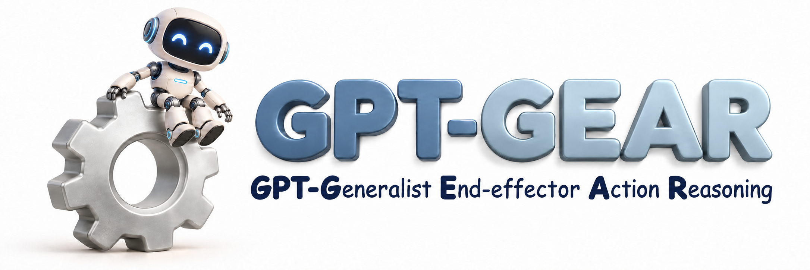
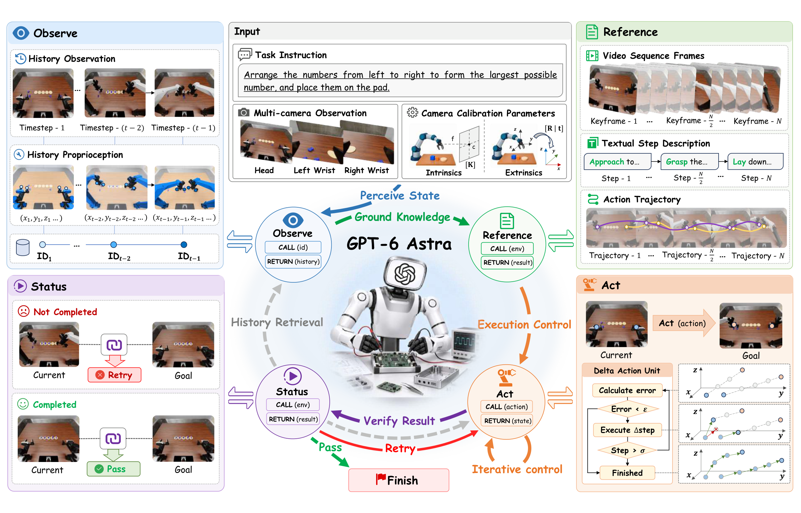
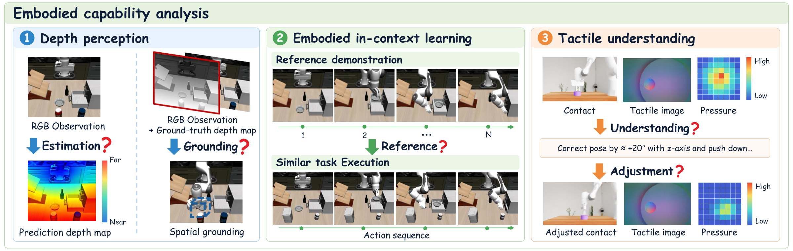
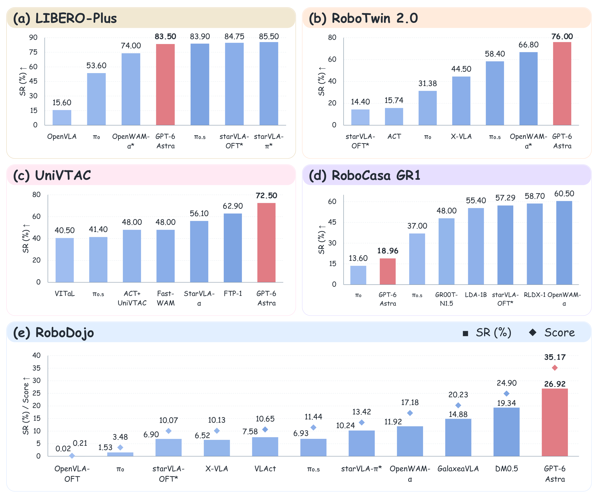
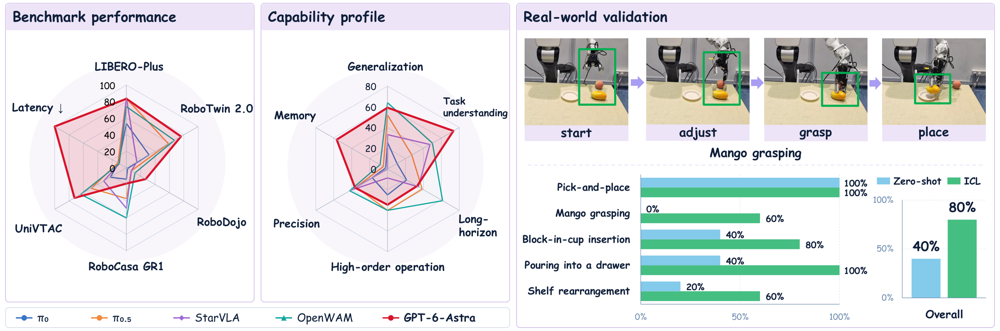
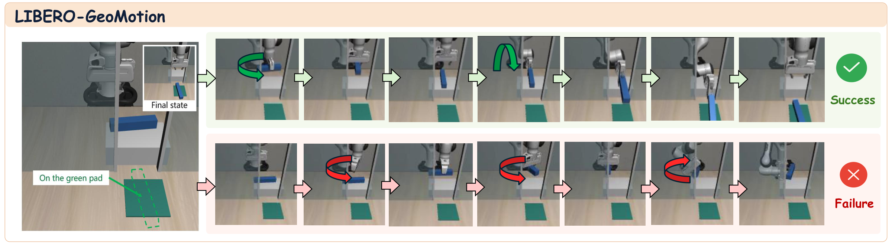

<h1 align="center">
  
</h1>

<p align="center">🌐 <a href="README.md">English</a> | <strong>🌐 简体中文</strong></p>

<p align="center">
  <strong>Large Multimodal Models for Direct Robot Control: GPT-6 as a Beginning</strong><br>
  <sub>探索视觉语言模型的具身能力与闭环机器人控制</sub>
</p>

<p align="center">
  <a href="https://arxiv.org/abs/2610.28259"></a>
  <a href="https://6uooon9.github.io/GPT-GEAR/"></a>
  <a href="#results"></a>
  <a href="docs/README.zh-CN.md"></a>
  <a href="LICENSE"></a>
</p>

<p align="center">
  📰 <a href="#news">最新动态</a> &nbsp;·&nbsp;
  🧭 <a href="#overview">项目概览</a> &nbsp;·&nbsp;
  🧠 <a href="#embodied-capabilities">具身能力分析</a> &nbsp;·&nbsp;
  📊 <a href="#results">评测结果</a><br>
  🤖 <a href="#capability-profile">能力画像</a> &nbsp;·&nbsp;
  📐 <a href="#libero-geomotion">LIBERO-GeoMotion</a> &nbsp;·&nbsp;
  🚀 <a href="#快速开始">快速开始</a> &nbsp;·&nbsp;
  📚 <a href="#documentation-and-code">文档与代码</a>
</p>

---

**让通用视觉语言模型直接操控机器人，会发生什么？它的表现真的有我们期待的那么好吗？**

欢迎来到 **GPT-GEAR**！我们提供了一个**支持多个仿真环境的机器人控制与评测框架**，把模型交互、参考示范、闭环执行和批量评测串在一起，让你更方便地探索通用模型的机器人操作能力。在这里，模型通过相机观察场景、参考示范学习操作，再亲自尝试，并根据机器人的反馈调整下一步。从理解一句指令到完成一次抓取，我们希望看看：**模型已经能做到什么，又会在哪里遇到困难？**

这项工作从**深度感知、具身上下文学习和触觉理解**出发，在 **LIBERO-plus、RoboTwin、UniVTAC、RoboCasa GR1 和 RoboDojo** 五个环境中探索模型的具身能力。欢迎阅读论文、浏览项目主页，也欢迎用这里的代码试试自己的任务，和我们一起探索通用模型走向物理世界的可能性！

<a id="news"></a>

## 📰 最新动态

- ✨ **2026/10/21** — 📄 [论文](https://arxiv.org/abs/2610.28259)与🌐 [项目主页](https://6uooon9.github.io/GPT-GEAR/)已开放！更多demo请参考我们的[主页](https://6uooon9.github.io/GPT-GEAR/)，也欢迎了解我们的方法和实验结果，交流想法与反馈。
- 📄 **2026/10/20** — **论文报告**：📄 [*Large Multimodal Models for Direct Robot Control: GPT-6 as a Beginning*](https://arxiv.org/abs/2610.28259)。我们分享了 GPT-6 Astra 在机器人操作中的能力、局限，以及值得继续探索的问题。

<a id="overview"></a>
<a id="method"></a>
<a id="工作方式"></a>

## 🧭 项目概览

**看一看，试一试，再根据反馈调整。** GPT-GEAR 为模型提供了一组与机器人交互的工具，让它把对场景的理解一步步转化为动作。相机画面告诉它“现在是什么样”，参考示范提供“可以怎样做”的线索，而执行反馈帮助它决定下一步。在这个过程中，模型可以回看之前的观测、借鉴示范中的操作，并在每次行动后重新观察场景。我们用这样的闭环，把模型的推理与实际执行联系起来，也让每一次尝试都成为了解其能力的窗口。

<p align="center">
  <a href="assets/readme/method.png">
    
  </a>
</p>

<p align="center">
  <sub>GPT-GEAR 项目概览 · 观察、参考、行动与反馈，串起模型和机器人的交互。🖼️ <a href="assets/readme/method.png">查看高清图 ↗</a></sub>
</p>

<a id="embodied-capabilities"></a>

<a id="具身能力分析"></a>

## 🧠 具身能力分析

**想让机器人把事情做好，先得看清空间、学会借鉴，也要读懂接触时的反馈。** 我们从这三个角度出发，看看模型能否估计与利用深度、把示范里的经验用到新场景，并根据触觉信息调整动作。下面这张图串起了我们最关心的三个问题。

<p align="center">
  <a href="assets/readme/embodied-capabilities.png">
    
  </a>
</p>

<p align="center">
  <sub>深度感知 · 具身上下文学习 · 触觉理解。🖼️ <a href="assets/readme/embodied-capabilities.png">查看高清图 ↗</a></sub>
</p>

<a id="results"></a>

## 📊 评测结果

**同一个模型，面对不同的机器人操作挑战，会有怎样的表现？** 我们在五个基准上进行了评测。下图中的红色标记展示了 **GPT-6 Astra** 的表现：既能看到它的潜力，也能看到仍待跨越的差距。

<p align="center">
  <a href="assets/readme/results.png">
    
  </a>
</p>

<p align="center">
  <sub>五个机器人操作基准上的表现。🖼️ <a href="assets/readme/results.png">查看高清图 ↗</a></sub>
</p>

<a id="capability-profile"></a>

<a id="能力画像与真机验证"></a>

## 🤖 能力画像

**从仿真中的分数，到真实机器人的一次抓取，我们想把模型的表现看得更完整一些。** 下面的雷达图汇总了基准表现与不同能力维度，右侧则展示了真实机器人上的操作，以及零样本与上下文学习（ICL）的对比。欢迎到我们的🌐 [项目主页](https://6uooon9.github.io/GPT-GEAR/)看看更多 demo，一起观察机器人实际操作时的表现！

<p align="center">
  <a href="assets/readme/capability-profile-real-world.png">
    
  </a>
</p>

<p align="center">
  <sub>基准表现 · 能力画像 · 真机验证。🖼️ <a href="assets/readme/capability-profile-real-world.png">查看高清图 ↗</a></sub>
</p>

<a id="libero-geomotion"></a>

## 📐 LIBERO-GeoMotion

**知道物体该放在哪里，是否就能把它转到合适的角度、顺利送到目标位置？** 为了进一步探索空间理解与实际执行之间的差距，我们提出了 **LIBERO-GeoMotion**：一个基于 LIBERO 资产构建、面向几何约束操作的新数据集与评测基准，包含 **9 类任务、36 个场景变体**。从让长条物体穿过狭窄开口，到把书竖直放入窄槽、让杯柄朝向指定方向，任务围绕**抓取姿态对齐、放置时的物体重定向，以及几何与顺序约束下的协调运动**展开。我们希望借助这些目标直观、动作却不简单的任务，看看模型能否协调平移与旋转，并提前考虑动作对周围物体的影响。

<p align="center">
  <a href="assets/readme/libero-geomotion.png">
    
  </a>
</p>

<p align="center">
  <sub>几何约束 · 姿态对齐 · 平移与旋转协调。🖼️ <a href="assets/readme/libero-geomotion.png">查看高清图 ↗</a></sub>
</p>

在[论文](https://arxiv.org/abs/2610.28259)的评测中，GPT-6 Astra 的零样本成功率为 **11.1%**，加入上下文示范后提升至 **50.0%**。示范带来了帮助，也留下了值得继续探索的动作协调难题。📦 **LIBERO-GeoMotion 数据集即将发布，敬请期待！**

更多实验与分析可以在顶部的论文入口中找到。想亲手跑一跑？从下面的环境介绍和🚀 [快速开始](#快速开始)出发，欢迎分享你的发现！

---

<a id="支持的环境"></a>
<a id="supported-environments"></a>

## 🌐 支持的环境

| 环境 | 任务示例 | 默认输入 | 使用指南 |
|---|---|---|---|
| RoboDojo | `align_blocks` | 三视角 RGB、双臂状态 | 📚 [环境配置](docs/environments/robodojo.zh-CN.md) |
| LIBERO-plus | `libero_spatial/0` | 双视角 RGB、单臂状态 | 📚 [环境配置](docs/environments/libero-plus.zh-CN.md) |
| RoboCasa GR1 | `PnPCupToDrawerClose` | RGB、双臂状态、测量深度 | 📚 [环境配置](docs/environments/robocasa-gr1.zh-CN.md) |
| UniVTAC | `insert_HDMI` | RGB、机器人状态、触觉合力 | 📚 [环境配置](docs/environments/univtac.zh-CN.md) |
| RoboTwin | `adjust_bottle` | 三视角 RGB、双臂状态 | 📚 [环境配置](docs/environments/robotwin.zh-CN.md) |

依赖和资产要求见 🔧 [安装指南](docs/installation.zh-CN.md)。

<a id="安装"></a>
<a id="installation"></a>

## 🔧 安装

运行任务前，先安装你要使用的仿真环境、准备好资产，并跑通其原生示例；无需安装全部五个环境。🔧 [上游仓库与安装入口](docs/installation.zh-CN.md#先安装所需的仿真环境)汇总在安装指南中。下面的命令只安装 GPT-GEAR 工具。

建议在 Linux 上使用独立的 Python 3.11+ 工具环境，以下以 Python 3.12 为例。在本仓库根目录执行：

```bash
python3.12 -m venv .venvs/codex-mcp
.venvs/codex-mcp/bin/python -m pip install -e '.[mcp]'
source .venvs/codex-mcp/bin/activate

gpt-gear --help
```

还需要准备：

- 已安装并完成认证的 Codex CLI；默认沿用本机模型配置。
- 至少一个已能运行的仿真环境，以及它自己的 Python 解释器、资产和渲染依赖。
- 录像或视频参考所需的 FFmpeg；视频参考还需要 FFprobe。

仿真 Python 与工具 Python 分开使用。安装本项目不会安装仿真器或下载资产，完整准备步骤见 🔧 [安装指南](docs/installation.zh-CN.md)。

<a id="快速开始"></a>
<a id="quick-start"></a>

## 🚀 快速开始

以下以已准备好的 LIBERO-plus 为例。所有命令在本仓库根目录执行，将 `/path/to/...` 替换为本机路径；其他环境的命令见 🚀 [环境运行指南](docs/running.zh-CN.md)。

<a id="1-检查环境"></a>
<a id="1-check-the-environment"></a>

### 🔍 1. 检查环境

```bash
gpt-gear doctor --benchmark libero-plus --task libero_spatial/0 \
  --env-root /path/to/LIBERO-plus \
  --sim-python /path/to/libero/bin/python
```

`doctor` 检查任务、资源、解释器和工具依赖，不启动仿真或模型，也不验证模型认证。

<a id="2-运行一个任务"></a>
<a id="2-run-a-task"></a>

### ▶️ 2. 运行一个任务

```bash
gpt-gear run libero_spatial/0 outputs/libero_first_run \
  --benchmark libero-plus \
  --env-root /path/to/LIBERO-plus \
  --sim-python /path/to/libero/bin/python \
  --seed 0 --init-state-index 0 --max-native-steps 600
```

该命令会启动仿真并调用模型。输出目录必须尚不存在，无需提前创建。指定模型时，在命令末尾加 `--codex-model 模型名`。

<a id="3-查看结果"></a>
<a id="3-inspect-the-results"></a>

### 📊 3. 查看结果

```bash
gpt-gear summarize outputs/libero_first_run
```

`result.json` 保存官方结果，`episode.mp4` 保存录像，`observations/` 保存观测。结果分类与排障方法见 📊 [结果与常见问题](docs/results.zh-CN.md)。

<a id="批量评测"></a>
<a id="batch-evaluation"></a>

## 🧪 批量评测

配置按用途分为 🧪 [`configs/queues/`](configs/queues/)（复现评测流程与条件对比）和 ⚙️ [`configs/single_task/`](configs/single_task/)（指定单个任务，每份只跑 1 个 episode）。完整清单见⚙️ [配置说明](configs/README.zh-CN.md)。

下面以 RoboCasa GR1 的 24 任务 × 20 seed 队列为例。先将🧪 [配置](configs/queues/robocasa_gr1.json)中的环境路径改为本机路径，再检查计划并执行：

```bash
# 打印计划，不启动仿真或模型。
gpt-gear queue configs/queues/robocasa_gr1.json outputs/gr1_24x20

# 执行队列。
gpt-gear queue configs/queues/robocasa_gr1.json outputs/gr1_24x20 --run
gpt-gear summarize outputs/gr1_24x20
```

一个队列可包含多个任务、seed 或环境。配置格式、续跑与重试见 🧪 [队列指南](docs/queues.zh-CN.md)。

<a id="使用参考示范"></a>
<a id="reference-demonstrations"></a>

## 🎬 使用参考示范

参考输入是可选的。你可以单独提供文字或视频，也可以组合文字、视频和轨迹。你可以自由搭配多种选择，探索更多可能。Astra会参考已有操作过程，并结合当前场景进行决策。

所有环境的参考文件都需在评测前准备。本项目提供从已有视频到文字步骤的生成、输入校验和读取。不下载数据、导出视频或生成轨迹（这些需要你从仿真环境里面自行导出）。

- 🎬 [将参考示范用于评测](docs/reference-protocol.zh-CN.md)
- 🎬 [根据已有视频生成文字步骤（可选）](docs/reference-format.zh-CN.md)

<a id="文档与代码"></a>
<a id="documentation-and-code"></a>

## 📚 文档与代码

| 想了解的内容 | 入口 |
|---|---|
| 从安装到第一个任务 | 🔧 [安装指南](docs/installation.zh-CN.md) → 🚀 [环境运行指南](docs/running.zh-CN.md) → 📊 [查看结果](docs/results.zh-CN.md) |
| 多任务评测与结果分析 | 🧪 [队列指南](docs/queues.zh-CN.md) → 📊 [结果与常见问题](docs/results.zh-CN.md) |
| 各环境的资产、观测与评测选项 | 📚 [五个环境的配置指南](docs/README.zh-CN.md#环境配置) |
| 控制、协议与环境适配 | 🏗️ [架构说明](docs/architecture.zh-CN.md) |
| 测试、问题反馈与贡献 | 💬 [贡献指南](CONTRIBUTING.zh-CN.md) |

```text
src/
├── execution/       # 启动、队列、会话、录像与结果
├── control/         # 机器人控制与位姿增量
├── protocol/        # MCP 工具、HTTP 通信与反馈
├── perception/      # 相机标定、深度与观测模态
├── environments/    # 五个仿真环境的适配
├── demonstrations/  # 参考处理与视频文字生成
└── prompts/         # 公共模型提示词
configs/
├── queues/          # 评测复现与条件对比队列
└── single_task/     # 单任务测试，每份 1 个 episode
tests/               # 离线回归测试
docs/                # 通用使用与开发文档
└── environments/    # 各仿真环境的配置指南
```

<a id="参与社区"></a>
<a id="join-the-community"></a>

## 💬 参与社区

欢迎通过仓库 Issues 分享问题、复现记录和新环境需求，也欢迎提交文档改进、测试或环境适配。提交前请参考 💬 [贡献指南](CONTRIBUTING.zh-CN.md)，说明运行环境、复现步骤和验证范围。

<a id="许可与致谢"></a>
<a id="license-and-acknowledgments"></a>

## ⚖️ 许可与致谢

本项目复用了 🌐 [RoboDojo](https://github.com/RoboDojo-Benchmark/RoboDojo)、🌐 [RPent](https://github.com/RLinf/RPent) 以及相关环境适配中的实现。不同来源文件保留相应的 MIT 或 Apache-2.0 许可与署名，详见 ⚖️ [LICENSE](LICENSE)、⚖️ [NOTICE](NOTICE) 和 ⚖️ [许可证目录](licenses/)。仿真环境、数据集和资产需另行准备。
